# UBA — one taxi-booking app, built four times

A note to my students:

Most courses show you one finished program and ask you to admire it. This repo
does the opposite. It builds **the same taxi-booking application four times
over**, and each version adds one more layer of what real software engineering
actually looks like. The booking rules never really change — a passenger books
a ride, a driver accepts it, the trip is completed and rated — but everything
*around* those rules grows up, version by version, until the last one looks like
something a company would run in production.

My intention is that you **follow the folders in order** and feel each jump for
yourself:

1. **[`uba-basic/`](uba-basic/)** — a console program that stores data in text
   files. Pure Python: variables, `if`, loops, functions, classes, inheritance.
2. **[`uba-gui/`](uba-gui/)** — the same logic with a web interface on top
   (NiceGUI), still saving to text files. You see that a *UI is just a layer*.
3. **[`uba-advanced/`](uba-advanced/)** — a real database (SQLite), hashed
   passwords and a proper "forgot password" flow. You see *data and security*
   grow up.
4. **[`uba/`](uba/)** — the production-shaped system: a FastAPI backend, a
   Next.js + Tailwind frontend, PostgreSQL, Docker, a Traefik reverse proxy,
   full observability (Prometheus, Loki, Grafana), an **AI fare model**, and an
   intentionally vulnerable **security lab** for the cyber-security track.

Each folder has its **own detailed README** — that is where the real teaching
is. This root file is the **map**: it shows, with diagrams, how the versions
relate, what layers each one has, who uses it, and how much of the networking
stack (the OSI model) each one actually exercises.

> How to read this repo: skim this map, then open `uba-basic/README.md` and
> work upward. Don't skip ahead — each version only makes sense once you have
> felt the problem the previous one left unsolved.

---

## How the four versions evolve

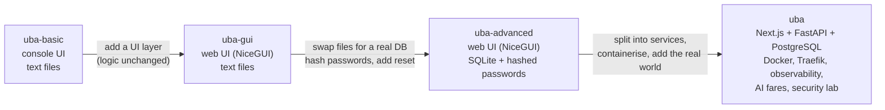

| Folder | Interface | Storage | Runs as | The new idea it teaches |
|---|---|---|---|---|
| `uba-basic` | Console menus | `.txt` files | one Python script | Objects, inheritance, file I/O |
| `uba-gui` | Web pages (NiceGUI) | `.txt` files | one Python script | Separating UI from logic |
| `uba-advanced` | Web pages (NiceGUI) | SQLite database | one Python script | Databases, password hashing, account recovery |
| `uba` | Next.js website | PostgreSQL | 10 containers behind a proxy | Services, HTTP APIs, Docker, proxies, observability, AI, security |

**What stays the same the whole way:** the domain model. A base `User` with
`Pax`, `Driver` and `Admin` inheriting from it; `Vehicle`, `Destination`,
`Booking`. Open `models.py` in any of the first three, or
`uba/backend/app/models.py`, and you will recognise the same shapes.

### A note on the diagrams below

For **each** version you get three views:

- **Layers** — the boxes the program is built from, top (what the user touches)
  to bottom (where data rests).
- **Use cases** — who uses it and what they can do (a UML-style use-case view).
- **OSI footprint** — which of the seven networking layers the version actually
  uses. This is where the evolution is most striking: `uba-basic` touches almost
  none of the stack, while `uba` lights up all seven. (✅ = used in this
  version, ⬜ = not used.)

---

## 1. `uba-basic` — console + text files

A single Python program you run in a terminal. No network, no web, no database.
Everything that matters about objects and inheritance is already here.

**Layers**

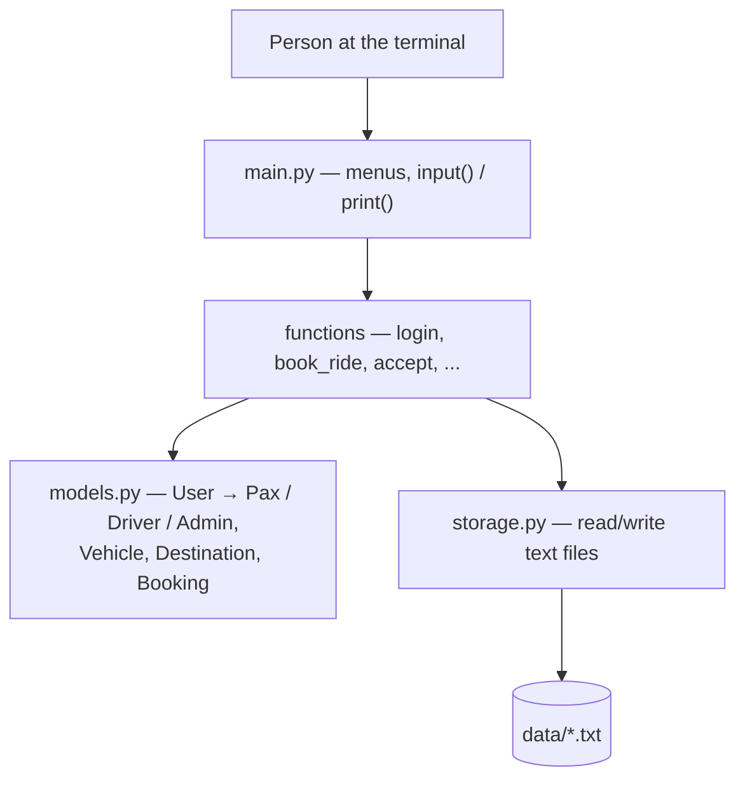

**Use cases**

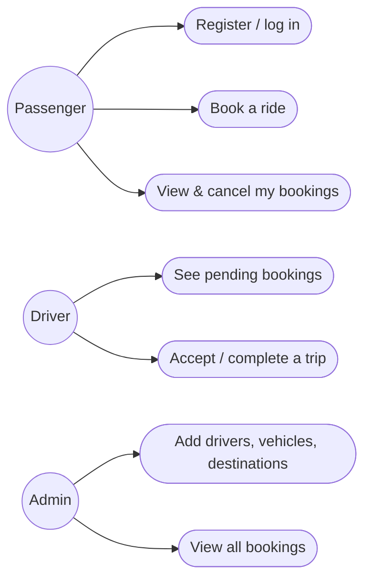

**OSI footprint** — only the application and the local disk are involved; there
is no network at all.

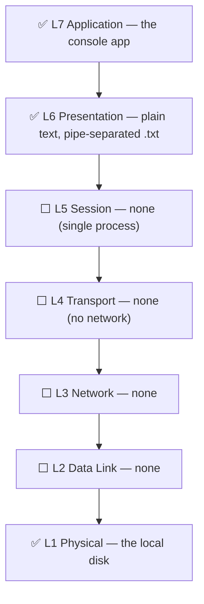

---

## 2. `uba-gui` — a web UI over the same logic

The exact same `models.py` and `storage.py`, now with a browser interface
(NiceGUI). The lesson: a user interface is a **layer you add**, not a rewrite.
Because NiceGUI runs a small web server, the browser now talks to Python over
HTTP and a WebSocket — so the networking stack starts to wake up (on `localhost`).

**Layers**

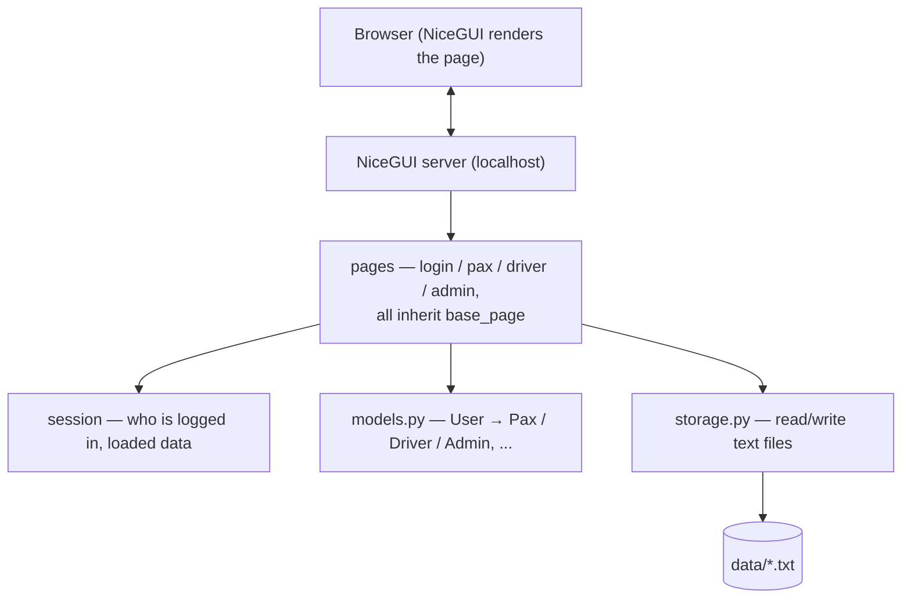

**Use cases** (same roles, now point-and-click; anyone can self-register)

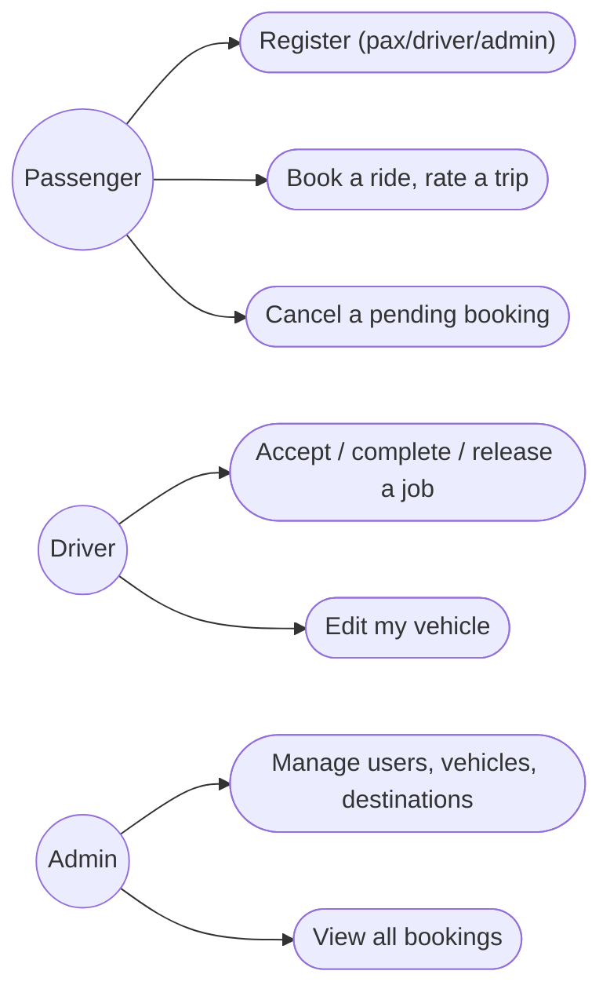

**OSI footprint** — a browser now talks to the server, so transport and network
layers come into play (over the loopback interface).

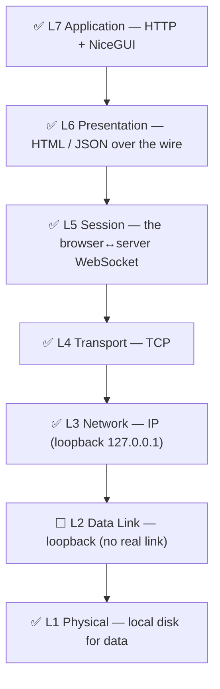

---

## 3. `uba-advanced` — a real database and real security

The screens barely change; the **floor underneath them** is replaced. Text
files become a SQLite database, passwords are no longer stored (only salted
hashes), and there is a security-question "forgot password" flow. This is the
version where *data integrity* and *security* become first-class.

**Layers**

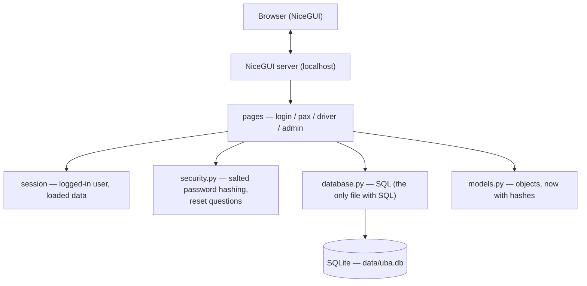

**Use cases** (adds account recovery)

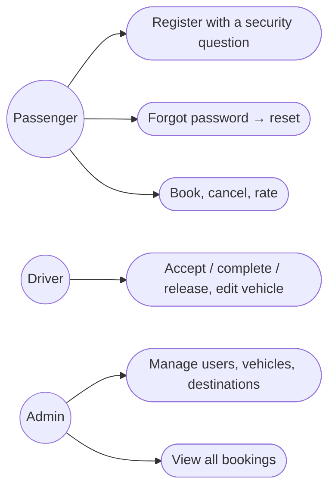

**OSI footprint** — same networking shape as `uba-gui` (browser ↔ local server);
the change is *below* the network, in how data is stored and secured.

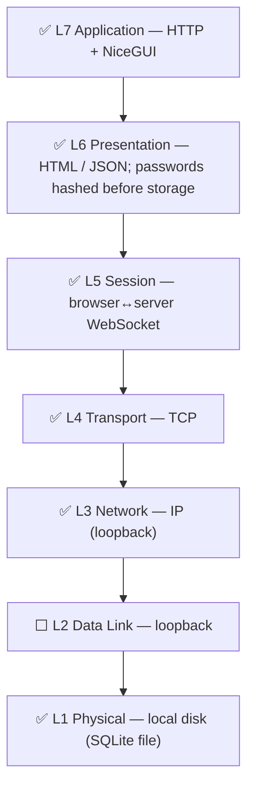

---

## 4. `uba` — the production-shaped system

Now the single program is split into **services** that each do one job and talk
over HTTP, all packaged in Docker and fronted by one reverse proxy. This is the
shape of real systems, and the folder's own README is a full tour. See also its
sections on the **AI fare model** and the **security lab**.

**Layers / architecture**

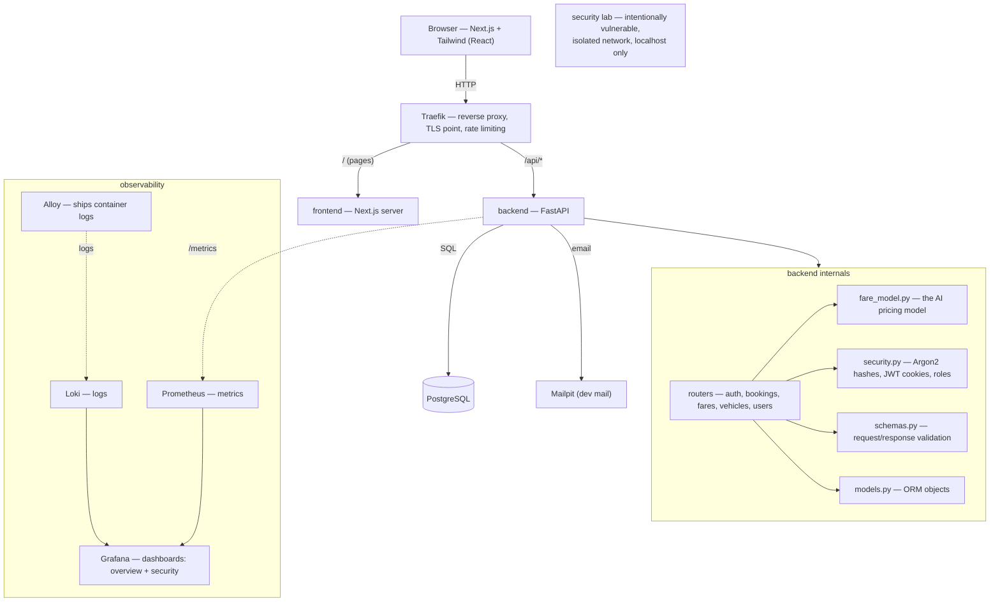

**Use cases** (passengers, drivers, admins — plus operators and security students)

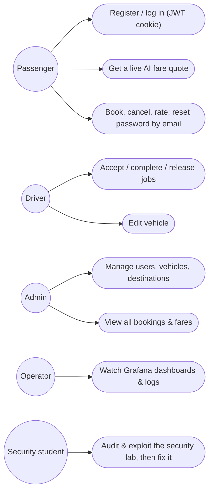

**OSI footprint** — a real distributed system now exercises the whole stack.

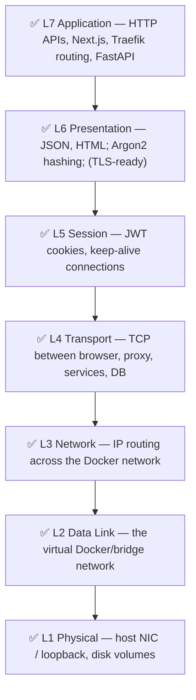

---

## Where to go next

- Start building your understanding at **[`uba-basic/`](uba-basic/)**.
- Each folder's `README.md` is the detailed guide for that version.
- The production app's guide, **[`uba/README.md`](uba/README.md)**, also lists
  *what to learn beyond your degree* to be able to build a system like it.
- Cyber-security track: **[`uba/securitylab/README.md`](uba/securitylab/README.md)**.

Build each version, break it, and read the next one's README only when you can
say exactly why the previous version needed to grow. That path — from a console
script to a containerised, observable, secured, intelligent system — is the real
subject of this course.
