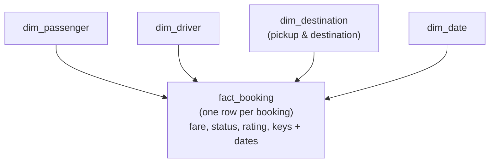

# Data engineering track

For the student heading toward **data engineer**.

The analyst (previous track) writes queries against the live app database. That
works for a demo, but in a real company you never let analysts hammer the
production database with heavy reporting queries — and the app's tables are
shaped for *transactions*, not *analysis*. The data engineer's job is to build
the pipe in between: move data out of the operational database into a **data
warehouse** modelled for reporting, on a schedule, with quality checks.

You will do this with **SQL** (to model and transform) and **Python** (to
orchestrate). Same two languages, bigger plumbing.

## What's here

| File | What it is |
|---|---|
| `warehouse_schema.sql` | A **star schema** in a separate `analytics` schema: one fact table, several dimensions. |
| `etl.py` | An Extract-Transform-Load job: reads the operational tables, (re)builds the warehouse. |
| `data_quality.sql` | Assertions that must hold after a load (no orphan facts, revenue adds up, no bad statuses). |

## The idea: a star schema

An analyst's life gets easy when data is shaped as one central **fact** (the
thing that happens — a booking) surrounded by **dimensions** (the things it
refers to — the passenger, the driver, the destination, the date).



Because everything is pre-joined and typed for reporting, a revenue-by-month
query becomes a one-liner, and it runs against the warehouse, not the app.

## Run it

See `extra/README.md` for how to reach the database. Then:

```
python etl.py                                   # extract → transform → load
psql "$UBA_DATABASE_URL" -f data_quality.sql    # verify the load
```

`etl.py` is **idempotent** — run it as often as you like; it rebuilds the
warehouse each time (a "full refresh"). It also creates the schema on first run,
so you do not have to run `warehouse_schema.sql` by hand (it is there to read).

## Deliberately left out (good next steps)

- **Incremental loads.** A full refresh is fine for a demo; real warehouses load
  only what changed since last time (watermarks on `updated_at`).
- **An orchestrator.** `etl.py` runs when you run it. In production a scheduler
  (Airflow, Dagster, Prefect) runs it nightly, retries it, and alerts on failure.
- **dbt.** Most teams now express the transform half in dbt (SQL + tests +
  lineage). `warehouse_schema.sql` and `data_quality.sql` map almost 1:1 to dbt
  models and tests — a great thing to port as an exercise.
- **A real second database.** Here the warehouse lives in an `analytics` schema
  in the same Postgres for simplicity; in production it is a separate system
  (BigQuery, Snowflake, Redshift).

## What to learn beyond your degree

Dimensional modelling (Kimball), SQL at depth (window functions, CTEs, upserts),
one orchestrator, dbt, and the discipline of **idempotent, tested** pipelines —
a pipeline you cannot safely re-run is a liability.
