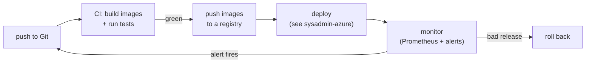

# DevOps / SRE track

For the student heading toward **DevOps engineer / site reliability engineer**.

The developer writes the code; the sysadmin runs the servers. DevOps is the glue
that makes shipping *safe and boring*: every change is automatically built,
tested and (when you're ready) deployed, the system tells you when it's unhealthy
before users do, and a bad release can be undone in minutes. The culture is
"automate everything you'd otherwise do by hand, especially the scary parts."

Your languages here are **YAML** (to describe pipelines and rules), **Python**
(to test and check), and **SQL** stays in reach for data-level checks.

## The loop you are building



## What's here

| File | What it is |
|---|---|
| `ci.yml` | A GitHub Actions pipeline: runs the backend tests and builds both images on every push. |
| `smoke_test.py` | A post-deploy health check — hits the real running system and fails loudly if a core user journey is broken. |
| `alerts.yml` | Prometheus alerting rules: the conditions that should wake someone up. |

> `ci.yml` is kept here so you can read it in context. To make it actually run,
> copy it to the **repository root** at `.github/workflows/ci.yml` — GitHub only
> looks there.

## Run the pieces

**The tests CI would run** (the same ones):
```
cd ../../backend
pip install -r requirements-dev.txt
pytest -q
```

**The smoke test**, against a running stack (`docker compose up -d`):
```
python smoke_test.py            # exits non-zero if a core journey is broken
```
A smoke test is what a pipeline runs *right after deploying* — if it fails, you
roll back automatically. Try breaking a route in the backend, rebuilding, and
watching `smoke_test.py` catch it.

**The alert rules**: wire `alerts.yml` into Prometheus by adding it under
`rule_files:` in `infra/prometheus/prometheus.yml`, then reload Prometheus.
Trigger one by hammering the login endpoint (high 5xx / failed logins) and watch
the alert move to `FIRING` in Prometheus → Alerts.

## The three ideas that matter most

1. **Everything in version control** — code, pipelines (`ci.yml`), infra
   (`sysadmin-azure/main.bicep`), alert rules. If it isn't in Git, it doesn't
   exist.
2. **Fast, automated feedback** — tests on every push; a smoke test on every
   deploy. Humans forget to check; pipelines don't.
3. **You can always go back** — versioned images and infra mean a rollback is
   "deploy the previous tag", not a panic.

## Deliberately left out (good next steps)

- **Actual deployment in the pipeline.** `ci.yml` builds and tests; wiring it to
  deploy to Azure (the `sysadmin-azure` track) is the capstone — ideally with a
  manual approval gate for production.
- **Alertmanager.** `alerts.yml` defines *when* to alert; routing those alerts to
  Slack/email/PagerDuty is Alertmanager's job.
- **Staging + canary + rollback automation**, and **SLOs/error budgets** — the
  SRE deep end.

## What to learn beyond your degree

Git and branching workflows, one CI/CD system (GitHub Actions is a fine start),
Docker, infrastructure-as-code, Prometheus alerting + Alertmanager, and the SRE
mindset (SLIs/SLOs, blameless post-mortems, "automate the toil"). Python is your
scripting and testing workhorse throughout.
