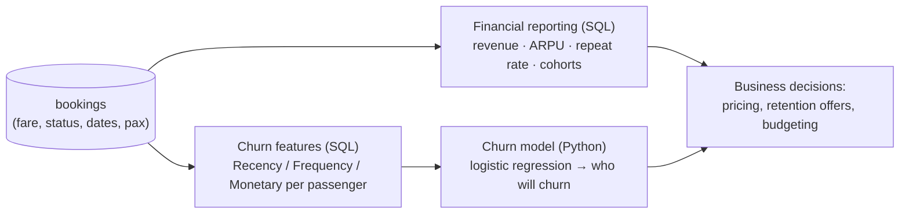

# Financial modelling, churn & reporting track

For the student heading toward **data science / FinTech / revenue analytics**.

The analytics track asks "what happened?". This track asks the two questions a
business most wants answered: **"how much money are we making?"** and **"who is
about to stop being a customer?"** The first is financial reporting; the second
is churn modelling. Both live squarely in **SQL** (to build the numbers and the
features) and **Python** (to model and report).

## Two jobs, one dataset



## What's here

| File | What it is |
|---|---|
| `revenue_reporting.sql` | The money report: revenue by period, ARPU, repeat-purchase rate, a retention cohort grid. |
| `churn_features.sql` | Per-passenger **RFM** features (Recency, Frequency, Monetary) and a churn label. |
| `churn_model.py` | Trains a transparent logistic-regression churn model on those features, reports accuracy and which factors drive churn. |
| `requirements.txt` | Python packages. |

## What "churn" means here

A ride marketplace has no subscription, so churn is defined by **behaviour**: a
passenger has *churned* if they used to book but have not booked within a recent
window (we use **30 days**). The model's job is to predict that *before* it
happens, from each passenger's recency, frequency and spend — so the business can
step in with an offer while the customer is still reachable.

## Run it

Reporting (numbers straight from SQL):
```
psql "$UBA_DATABASE_URL" -f revenue_reporting.sql
psql "$UBA_DATABASE_URL" -f churn_features.sql     # inspect the feature table
```

The model (see `extra/README.md` for reaching the DB):
```
pip install -r requirements.txt
python churn_model.py            # uses real data; falls back to synthetic if sparse
python churn_model.py --demo     # force a realistic synthetic dataset to learn on
```

> The demo database is tiny, so `churn_model.py` will **generate a synthetic
> population** when there isn't enough real history to learn from. It says
> clearly which mode it's in. The *technique* is identical either way — that is
> the point.

## Why a logistic regression (not a neural net)?

Same reason the main app's fare model is transparent rules: a churn score you can
**explain** ("this customer is high-risk mainly because they haven't booked in 40
days") is worth more to a retention team than a black box with a slightly better
score. `churn_model.py` prints the coefficient for each feature so you can read
the story. Fancier models (gradient boosting, etc.) are a natural next exercise —
measure whether the extra accuracy is worth the lost explainability.

## Deliberately left out (good next steps)

- **Proper time-based validation.** Churn is a forecasting problem; you should
  train on an earlier period and test on a later one, not a random split.
- **Class imbalance handling, calibration, and a lift/gain chart** to decide who
  to actually target first.
- **Lifetime value (LTV).** Pair churn probability with predicted spend to rank
  customers by *value at risk*, not just risk.
- **A real reporting cadence.** Wire the SQL into the `data-engineering` warehouse
  and refresh it nightly.

## What to learn beyond your degree

SQL window functions and cohort analysis, pandas, the basics of supervised
learning and honest model evaluation (train/test discipline, precision/recall,
not just accuracy), and — most important — how to translate a model's output into
a decision a business will actually make.
