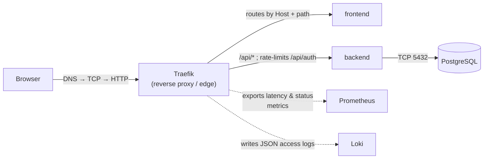

# Network & communications engineering track

For the student heading toward **network / communications engineer**.

Every click in UBA is a packet's journey: browser → DNS → TCP → TLS → a reverse
proxy → the right service → the database → and all the way back, in milliseconds.
The network engineer owns that path. You make sure requests reach the right
place, quickly, reliably and securely — and when they don't, you can *prove*
where the time or the failures are going.

You will not write much application code. Your tools are the **observability the
system already emits** (Prometheus metrics, Traefik access logs, Loki) plus
packet-level utilities — and **Python** to turn raw telemetry into a clear
report.

## The request path (and where it can go wrong)



Failure modes you learn to spot: DNS not resolving, TLS mismatches, the proxy
routing to the wrong service, a slow upstream, connection pool exhaustion at the
database, or a client hammering the edge (and getting rate-limited).

## Where UBA sits on the OSI model

| OSI layer | In UBA |
|---|---|
| 7 Application | HTTP, the REST API, Traefik routing rules |
| 6 Presentation | JSON/HTML, TLS encryption (in the cloud), Argon2 at rest |
| 5 Session | login cookies (JWT), keep-alive connections |
| 4 Transport | TCP between browser, proxy, services and DB |
| 3 Network | IP routing across the Docker bridge network |
| 2 Data link | the virtual Docker network / your NIC's link |
| 1 Physical | the host machine's network card and cabling |

## What's here

| File | What it is |
|---|---|
| `latency_report.py` | Pulls request-rate, status-code and p50/p95/p99 latency per route from Prometheus and prints a report. |
| `analyze_access_logs.py` | Reads Traefik's JSON access logs from Loki and summarises status codes, slowest paths and the busiest clients. |

Both use only the Python standard library and talk to the stack through Traefik,
so there is nothing to `pip install` and no database access needed.

## Run it

With the stack up (`docker compose up -d`):

```
python latency_report.py            # from Prometheus metrics
python analyze_access_logs.py       # from Traefik logs via Loki
```

Generate some traffic first (click around the app, or run the `devops` track's
`smoke_test.py`) so there is something to measure. To see the **rate-limiter**
fire at the network edge, hit the login endpoint hard and watch 429s appear.

## Deliberately left out (good next steps)

- **Packet capture.** To truly see layers 3–4, run `tcpdump`/Wireshark on the
  Docker bridge or `docker run --net container:uba-backend-1 nicolaka/netshoot`
  and inspect real packets. A great lab exercise.
- **TLS.** The demo is plain HTTP. Adding Let's Encrypt certs to Traefik (and
  seeing the handshake) is the natural layer-6 follow-up.
- **Load testing.** Tools like `k6` or `hey` drive controlled load so your
  latency percentiles mean something under stress.

## What to learn beyond your degree

The TCP/IP and OSI models in practice, DNS, HTTP/1.1 vs HTTP/2, TLS, reverse
proxies and load balancers, rate limiting, and reading telemetry (Prometheus,
PromQL, access logs). Python is your analysis glue; `tcpdump`, `dig`, `curl -v`
and `ss` are your microscopes.
