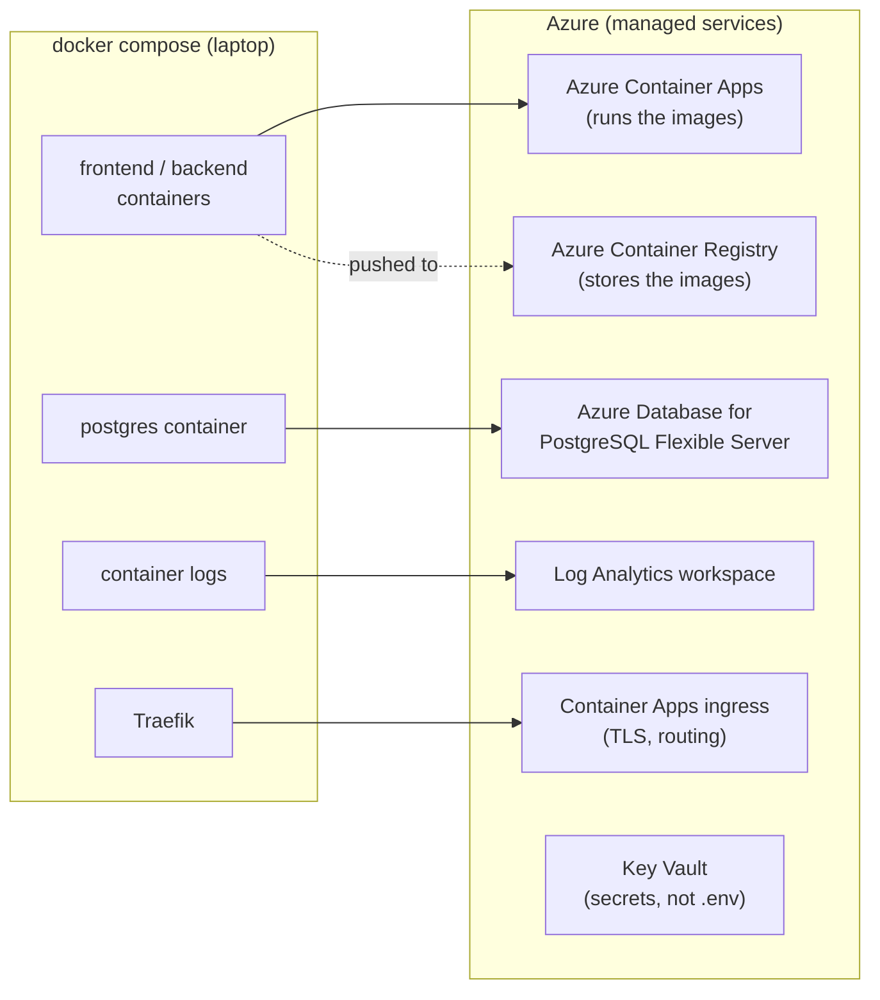

# Systems administration track — on Microsoft Azure

For the student heading toward **systems administrator / cloud ops**, focused on
**Azure**.

The developer builds UBA; the sysadmin is responsible for it *existing and
staying up* somewhere real. On your laptop `docker compose up` is enough. In the
cloud, someone has to create the servers, the managed database, the container
registry, the secrets store and the logging — and then keep them patched, backed
up, monitored and affordable. On Azure, that is your job.

Infrastructure is described in **Bicep** (Azure's native infrastructure-as-code)
and driven with the **`az` CLI**; day-to-day database care stays in **SQL**, and
we wrap the repetitive operations in **Python** so they are repeatable.

## How the laptop stack maps to Azure



The lesson: in the cloud you stop *running* most things and start *configuring
managed versions* of them. You do not babysit a Postgres process; you configure
a Flexible Server and let Azure patch and back it up.

## What's here

| File | What it is |
|---|---|
| `main.bicep` | Infrastructure as code: registry, Postgres, Log Analytics, Key Vault, Container Apps environment + the backend app. |
| `provision.sh` | The `az` CLI walkthrough: resource group → build & push image → deploy the Bicep. |
| `db_maintenance.sql` | A DBA's routine health checks and maintenance for the managed Postgres. |
| `ops.py` | A small Python wrapper over `az` for everyday ops (status, logs, restart, scale). |

## Run it (on your own Azure subscription)

> ⚠ This **creates real, billable resources**. Use a free/student subscription,
> pick the cheapest SKUs (already defaulted here), and run the teardown at the
> end. Read every command before you run it — that is the sysadmin's first rule.

```
az login
bash provision.sh            # walks through resource group, image, deploy
python ops.py status         # see the running app
python ops.py logs           # stream its logs
```

Teardown (stops the bill): `az group delete --name uba-demo-rg --yes`.

## Secrets: the big difference from the laptop

On your laptop, `docker-compose.yml` has the database password in plain sight.
In Azure that is forbidden. Secrets live in **Key Vault**, and Container Apps
reads them at start-up via a managed identity — the password is never in the
image, the repo, or an environment file you might commit. `main.bicep` shows the
wiring.

## Deliberately left out (good next steps)

- **The frontend app and ingress rules** — `main.bicep` deploys the backend to
  keep it readable; adding the frontend container app is a natural exercise.
- **Private networking** — the demo Postgres allows Azure services through the
  firewall; production puts the database on a private VNet with no public access.
- **CI/CD to Azure** — here you deploy by hand; the `devops` track shows how a
  pipeline would build, push and deploy on every commit.
- **Monitoring & alerts** — logs flow to Log Analytics, but you would add Azure
  Monitor alert rules (CPU, 5xx, DB connections) on top.

## What to learn beyond your degree

The Azure resource model (resource groups, RBAC, managed identity), Bicep (or
Terraform), the `az` CLI, Key Vault, how managed databases handle backups and
failover, and Linux/container fundamentals. SQL stays essential — a cloud DBA
still tunes queries and reads `pg_stat_*`.
